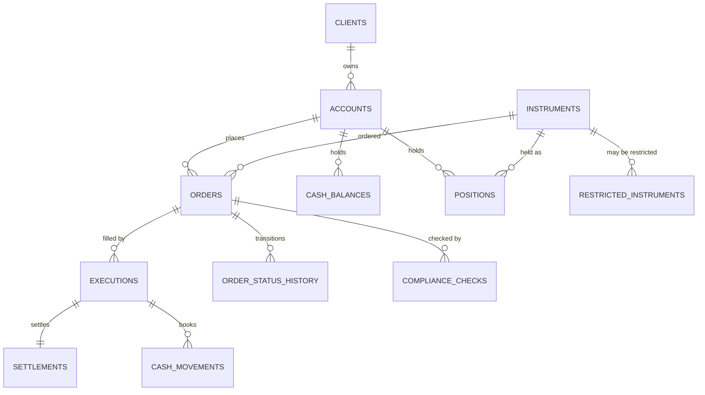

# Fin OMS API

An Order Management System (OMS): order
placement/lifecycle, execution, and position-keeping for client portfolios,
on PostgreSQL. This is the OLTP counterpart to the sibling
[fin-analytics-api](https://github.com/SaaSGun/fin-analytics-api) repo.

## Live demo

Deployed on Cloud Run: **https://fin-oms-api-miatwtkcba-ez.a.run.app**

- [`/health`](https://fin-oms-api-miatwtkcba-ez.a.run.app/health) —
  unauthenticated, confirms the service is up.
- [`/docs`](https://fin-oms-api-miatwtkcba-ez.a.run.app/docs) — interactive
  Swagger UI for the full API surface (every endpoint, request/response
  schemas, scopes required).

No API key is published here deliberately — this is a live production-like
deployment with a real database behind it, and a key committed to a public
repo is effectively public forever (scraped within minutes, even after
later revoking it), so a write-capable key here would mean strangers
mutating the same demo data. `/docs` is enough to see the full request/
response shape, the pagination envelope, and the `401`/`403` behavior of
the auth layer (`app/auth.py`) without needing one.

## The concurrency-control story (the point of this repo)

Two mechanics carry the weight here, used side by side on purpose because
they solve different problems:

1. **Buying-power / position reservation.** `cash_balances.reserved_amount`
   and `positions.reserved_quantity` turn "is there enough?" into a write,
   not just a read — placing an order locks the relevant row
   (`SELECT ... FOR UPDATE`) and increments its reservation in the same
   transaction. Without this, two concurrent orders against the same
   account would both read the same unreserved balance and both pass the
   check; a row lock alone doesn't stop that, because nothing has changed
   yet for the second reader to block on. See
   [`app/services/order_placement.py`](app/services/order_placement.py).
2. **Optimistic locking for order state transitions.** `orders.version`
   backs a conditional `UPDATE ... WHERE version = :expected`; zero rows
   affected means someone else changed the order first (e.g. it got filled
   while a cancel was in flight) → `409 Conflict`. Used here instead of a
   pessimistic lock because a conflicting *writer* should fail loudly, not
   block and then apply a cancel that no longer makes sense. See
   [`app/services/cancellation.py`](app/services/cancellation.py).
3. Recording a fill ([`app/services/execution.py`](app/services/execution.py))
   is one multi-table atomic transaction: order status/version, reservation
   release, position (upsert + average cost), cash balance, a cash-ledger
   row, and a settlement row, all in one commit.

`tests/test_concurrency.py` exercises both mechanics with genuinely
concurrent requests (`asyncio.gather`), not just sequential assertions.

## Schema



14 tables, defined in [`app/models/`](app/models/) and created by the
hand-written Alembic migration
[`alembic/versions/0001_initial_schema.py`](alembic/versions/0001_initial_schema.py).
Status/side/type columns use `CHECK` constraints rather than native
Postgres `ENUM` types — enums require `ALTER TYPE ... ADD VALUE` for every
new value down the line; `CHECK` constraints are trivially alterable and
keep migrations simple. All primary keys are app-generated UUIDs
(`uuid.uuid4()`), not a Postgres extension, to keep the migration
dependency-free. Foreign keys are `ON DELETE RESTRICT` throughout — this is
a ledger-shaped domain; nothing here should ever cascade-delete.

## Project structure

```
app/
  config.py, db.py          # settings, async engine/session
  main.py                    # FastAPI app, middleware, routers, /health
  auth.py, rate_limit.py      # API-key auth + scopes, token-bucket rate limiting
  pagination.py, etag.py       # cursor pagination, ETag/If-Match helpers
  idempotency.py, audit.py,     # idempotency-key cache, audit trail, transactional
    outbox.py                   #   outbox — see "Phase 2.5" below
  observability.py                # structured JSON logging, request-ID middleware
  models/                           # SQLAlchemy ORM models, one module per concern
  schemas/                           # Pydantic request/response models (+ common.py: Envelope/Meta/Pagination)
  services/                           # the transactional engine — the core of this repo
  routers/                             # thin HTTP layer over services/
alembic/                                # migrations
scripts/                                  # seed_demo_data.py, manage_api_keys.py, outbox_relay.py
tests/                                      # pytest, against a real Postgres (see below)
terraform/                                    # GCP IaC — see "Deployment (Phase 3)" below
.github/workflows/                              # ci.yml (lint+test), deploy.yml (build/migrate/deploy)
Dockerfile, .dockerignore                         # container image for Cloud Run
```

## Setup

Python interpreter for this repo: `C:\Apps\Anaconda\fin_oms_api\python.exe`
(conda env; see `.claude/claude.md`).

```
C:\Apps\Anaconda\fin_oms_api\python.exe -m pip install -r requirements-dev.txt
```

### Local Postgres

If Docker is available:

```
docker compose up -d
```

**This machine has neither Docker nor WSL installed**, so Postgres instead
runs via a dedicated conda env with the `postgresql` conda-forge package —
no admin rights needed, consistent with how the sibling repo's Python env
also lives under `C:\Apps\Anaconda` rather than under the user profile
(blocked by this machine's group policy):

```
conda create -p C:\Apps\Anaconda\fin_oms_db -c conda-forge postgresql=16 -y

set BIN=C:\Apps\Anaconda\fin_oms_db\Library\bin
set PGDATA=C:\Apps\Anaconda\fin_oms_db\pgdata
%BIN%\initdb.exe -U postgres -A trust -E UTF8 --locale=C
%BIN%\pg_ctl.exe -D %PGDATA% -l C:\Apps\Anaconda\fin_oms_db\pg.log start
%BIN%\createuser.exe -U postgres -s fin_oms
%BIN%\psql.exe -U postgres -c "ALTER USER fin_oms WITH PASSWORD 'fin_oms'"
%BIN%\createdb.exe -U postgres -O fin_oms fin_oms
%BIN%\createdb.exe -U postgres -O fin_oms fin_oms_test
```

Note the binaries live under `Library\bin`, not `Scripts` (conda's usual
convention for pure-Python packages doesn't apply to this native-binary
one). `-E UTF8 --locale=C` matters: the Windows default locale initializes
the cluster as `WIN1252`, which can't store the non-ASCII characters this
demo's seed data uses (e.g. an em dash). `PGDATA` must live outside the
OneDrive-synced repo path — both because Windows group policy on this
machine blocks executables launched from under the user profile/OneDrive,
and because OneDrive syncing a live Postgres data directory mid-write
would corrupt it.

To stop it later: `%BIN%\pg_ctl.exe -D %PGDATA% stop`.

### Migrations

```
alembic upgrade head
```

### Seed demo data

```
C:\Apps\Anaconda\fin_oms_api\python.exe scripts\seed_demo_data.py
```

Not idempotent — run it once against a fresh database. It prints a
`read`-only API key and a `read`+`trade`+`admin` key at the end; on a
database it's already been run against, issue more keys instead with
`scripts/manage_api_keys.py create --client-name "..." --scopes read,trade`.

### Run the API

```
C:\Apps\Anaconda\fin_oms_api\python.exe -m uvicorn app.main:app --reload
```

Then open `http://localhost:8000/docs` for interactive Swagger UI.

## Running tests

Tests run against a real Postgres database (`fin_oms_test` by default,
override via `TEST_DATABASE_URL`) — **not mocks**, deliberately: the thing
under test is Postgres-level locking behavior, which no mock can reproduce
(a deviation from the sibling repo's fully-offline, mocked test strategy,
which is the right call there but would defeat the purpose here).

```
C:\Apps\Anaconda\fin_oms_api\python.exe -m pytest
```

Lint: `C:\Apps\Anaconda\fin_oms_api\python.exe -m ruff check .`

## Known Phase-1 simplifications

- No live market/pricing feed — `MARKET` orders require a caller-supplied
  `reference_price`; account valuation (`GET /accounts/{id}/summary`) is
  "at cost," not mark-to-market.
- No short selling — `SELL` orders require an existing, sufficient position.
- Settlement is a status lifecycle (`PENDING`/`SETTLED`/`FAILED`) via an
  explicit admin endpoint (`POST /settlements/{id}/settle`), not an
  automated T+2 scheduler — cash/positions already moved atomically at
  fill time, so settlement here is operational tracking, not a second
  money-movement step.
- Concentration limits are an absolute max-position-quantity cap, not a
  %-of-portfolio-value limit (which would need a live valuation engine).
- No deployment infra yet — see the roadmap below.

## API maturity (Phase 2)

Mirrors the sibling repo's API-maturity choices, adapted for async
FastAPI + Postgres instead of sync FastAPI + BigQuery:

- **Response envelope + cursor pagination**: every endpoint returns
  `{"data": <object|array>, "meta": {"pagination": {...}|null}}`
  ([`app/schemas/common.py`](app/schemas/common.py)). List endpoints use
  keyset (not offset) pagination via `cursor`/`limit` query params
  ([`app/pagination.py`](app/pagination.py)) — results stay correct even
  if rows change between page fetches. `/health` stays bare, unwrapped.
- **API-key auth + scopes**: send `X-API-Key`. Three tiers —
  `read` (every GET), `trade` (place/cancel an order — a real client's
  access), `admin` (record an execution / settle — back-office actions
  simulating the market and settlement, which a real client would never
  have). Keys are SHA-256-hashed in the `api_keys` table, never stored
  raw. Manage them with
  [`scripts/manage_api_keys.py`](scripts/manage_api_keys.py)
  (`create`/`list`/`revoke`); `scripts/seed_demo_data.py` also seeds a
  `read`-only and a `read`+`trade`+`admin` demo key on a fresh database.
- **Rate limiting**: per-client token bucket (5 req/s, burst 20 by
  default), 429 + `Retry-After` on an empty bucket. `/health` and
  failed-auth responses never consume a token.
- **Structured logging**: every request logs one JSON line
  (`app/observability.py`) with a `request_id` (echoed from the caller or
  generated) that also tags the service-layer `domain_event` log lines
  for that request (`order_placed`/`order_rejected`/`execution_recorded`/
  `order_cancelled`/`cancellation_conflict`/`settlement_updated`) — this
  repo's analog of the sibling's per-query BigQuery-cost logging, but
  for OMS audit/ops visibility instead of query cost.

## Idempotency, optimistic concurrency, outbox/CDC, audit trail (Phase 2.5)

Four patterns worth having genuinely, not partially — each ties directly
into the "transactional database design" this repo exists to showcase,
so all four are implemented so the extra record (idempotency cache row /
outbox row / audit row) is written in the **same transaction** as the
business effect it describes — see each service's docstring in
`app/services/` for exactly where.

- **Idempotency keys**: `Idempotency-Key` is required on every mutating
  endpoint (`POST /orders`, `/orders/{id}/cancel`,
  `/orders/{id}/executions`, `/settlements/{id}/settle`) — `422` if
  missing. Replaying the same key + body returns the cached response
  without touching the database again; the same key with a *different*
  body is `409`. See [`app/idempotency.py`](app/idempotency.py).
- **Optimistic concurrency over HTTP**: `GET /orders/{id}` and
  `GET /settlements/{id}` set `ETag: "<version>"`. Cancelling an order or
  settling a settlement **requires** `If-Match` — `428` if missing, `412`
  if the version has moved on. This is what makes the guarantee genuine
  from the caller's point of view (staleness *they* could have observed),
  not just an internal detail — see [`app/etag.py`](app/etag.py) and the
  `version` columns on `orders`/`settlements`. Cash balances/positions
  deliberately don't get this — nothing ever mutates one as a standalone
  resource, so there'd be nothing to send `If-Match` against.
- **Outbox pattern / CDC**: every service call stages one row in
  `outbox_events`, same transaction as the business write. There's no
  Kafka broker in this environment, so `scripts/outbox_relay.py` — safe
  to run as multiple concurrent workers via `SELECT ... FOR UPDATE SKIP
  LOCKED` — publishes to a local `outbox_stream.jsonl` file standing in
  for a topic. Swapping in a real broker (Kafka, or GCP Pub/Sub, which
  fits this project's deployment direction better) only ever touches
  `app/outbox.py`'s `Publisher`, never the transactional-write side.
- **Audit trail**: `audit_log` (immutable by convention — nothing here
  ever updates or deletes a row in it) records who did what, with full
  before/after state, for every order placement/rejection/fill/
  cancellation and every settlement update. Deliberately a separate table
  from `outbox_events`, even though both are written at the same moment
  for the same operation — one is for a human investigator asking "what
  happened and who did it" (kept forever), the other for a downstream
  system consuming a change stream (archived once published).

## Deployment (Phase 3)

Cloud Run (`fin-oms-api`) + Cloud SQL for Postgres, both in
`europe-west4`. Deliberately **always-on**, not spin-up-on-demand — a
reviewer's link should work at any time — so Cloud SQL runs continuously
on the smallest shared-core tier (`db-f1-micro`, no SLA, ~$8-10/month;
an accepted tradeoff for a portfolio project, not a production system).
Cloud Run itself still scales to zero when idle.

- **`Dockerfile`**: multi-stage build, non-root runtime user,
  `--no-access-log` on uvicorn (the structured request-logging middleware
  from Phase 2 already covers that), respects Cloud Run's `$PORT`.
- **Cloud SQL connectivity**: Cloud Run's native Cloud SQL integration
  (a mounted `/cloudsql` Unix socket) — no sidecar proxy, no connector
  library. `app/config.py` needed no change; only the `DATABASE_URL`
  value differs between local `.env` and Cloud Run's env.
- **Secrets**: the DB password never appears in the Cloud Run service
  spec. Terraform writes the full `DATABASE_URL` (and, separately, the
  raw password for CI's migration step) into Secret Manager; Cloud Run
  sources its env var via `secret_key_ref`, not a literal value — see
  [`terraform/secret_manager.tf`](terraform/secret_manager.tf).
- **Migrations**: run from CI, as a distinct step *before* the new
  revision deploys — never from inside the app container at startup
  (concurrent instances racing `alembic upgrade head` is exactly what
  that avoids). GitHub Actions has no VPC path to Cloud SQL, so
  [`deploy.yml`](.github/workflows/deploy.yml) tunnels through the
  Cloud SQL Auth Proxy to run `alembic upgrade head` against `localhost`.
- **CI/CD**: [`ci.yml`](.github/workflows/ci.yml) runs `ruff` + the full
  pytest suite against a `postgres:16` service container on every PR and
  push (GitHub's runners have Docker even though this machine doesn't).
  [`deploy.yml`](.github/workflows/deploy.yml) builds the image, pushes
  it to Artifact Registry, runs migrations, then deploys — all
  authenticated via keyless **Workload Identity Federation** (no
  service-account JSON key ever exists), mirroring the sibling
  `fin-analytics-api` repo's setup.
- **IaC**: [`terraform/`](terraform/) owns the GCP project's APIs, the
  Cloud SQL instance, Artifact Registry repo, Secret Manager secrets, the
  two service accounts (Cloud Run runtime vs. GitHub Actions deployer),
  the WIF pool/provider, and the Cloud Run service itself — whose
  container `image` Terraform deliberately stops managing after the
  first `apply` (`lifecycle.ignore_changes`), since CI/CD owns deploys
  from then on. State is remote (GCS backend); `terraform apply` runs
  from **Google Cloud Shell**, not this machine (the Terraform CLI can't
  execute locally here — an AppLocker/WDAC restriction, not a code
  issue).
- **Ingress**: the Cloud Run service allows unauthenticated invocations
  (`allUsers` as `roles/run.invoker`) — the app's own API-key scopes
  (Phase 2) are the real gate; a second IAM-level gate in front of them
  would only add friction for a reviewer, not security.

### One-time manual bootstrap (not owned by CI/CD)

0. **Get `terraform/` (and the rest of this commit) into Cloud Shell.**
   Nothing is committed to this repo yet, so Cloud Shell can't just
   `git clone` it. Either commit + push first, or upload the `terraform/`
   folder into Cloud Shell manually (its editor supports drag-and-drop
   upload) — your call, just don't skip this, `terraform init` has
   nothing to run otherwise.
1. `gcloud projects create <PROJECT_ID>`, then find your billing account
   id with `gcloud billing accounts list` and link it:
   `gcloud billing projects link <PROJECT_ID> --billing-account=<ACCOUNT_ID>`.
2. Sanity-check the baseline APIs Terraform itself needs are on (new
   projects usually have these already, but a fresh project can
   occasionally lack `serviceusage.googleapis.com`, which blocks
   Terraform from enabling anything else):
   `gcloud services enable serviceusage.googleapis.com cloudresourcemanager.googleapis.com --project=<PROJECT_ID>`.
3. Create the GCS bucket for Terraform remote state, e.g.
   `gcloud storage buckets create gs://<PROJECT_ID>-tfstate --location=europe-west4`.
4. From Cloud Shell, in `terraform/`:
   `terraform init -backend-config="bucket=<PROJECT_ID>-tfstate"`, then
   `terraform plan -var project_id=<PROJECT_ID>` (review it), then
   `terraform apply -var project_id=<PROJECT_ID>`. Cloud SQL instance
   creation alone can take several minutes — that's normal.
5. Copy five Terraform outputs plus four fixed values into the GitHub
   repo's **Settings → Secrets and variables → Actions → Variables tab**
   (not Secrets — `deploy.yml` reads these as `vars.*`, so a value saved
   as a Secret instead will silently resolve empty):
   - `GCP_PROJECT_ID` = `<PROJECT_ID>`
   - `GCP_REGION` = `europe-west4`
   - `GCP_SERVICE_NAME` = `fin-oms-api`
   - `GCP_ARTIFACT_REPO` = `fin-oms-api`
   - `GCP_DB_USER` = `fin_oms`
   - `GCP_DB_NAME` = `fin_oms`
   - `GCP_SQL_CONNECTION_NAME` ← `cloudsql_connection_name` output
   - `GCP_DEPLOYER_SA` ← `deployer_service_account_email` output
   - `GCP_WORKLOAD_IDENTITY_PROVIDER` ← `workload_identity_provider` output
6. Push to `main` (or merge a PR into it) — `deploy.yml` takes it from
   there. Confirm with `curl <cloud_run_url output>/health`.

## Roadmap

Nothing currently planned beyond Phase 3.
