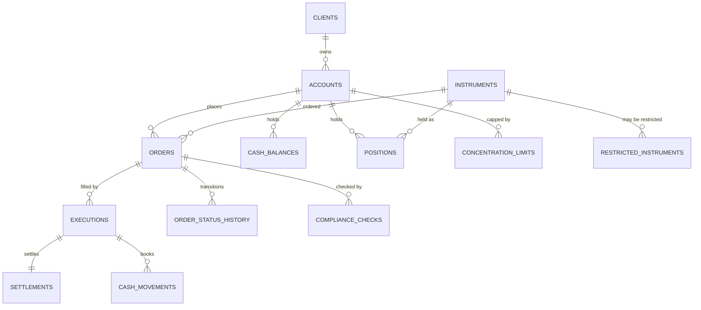

# Fin OMS API

An Order Management System (OMS) for a wealth manager: order placement
and lifecycle, pre-trade compliance, executions, settlement, and
position/cash keeping for client accounts — built to show transactional
database design and concurrency control on PostgreSQL.

It is the OLTP counterpart to
[fin-analytics-api](https://github.com/SaaSGun/fin-analytics-api), which
serves the same domain's analytics (OLAP) side from BigQuery with the same
API conventions.

**Stack**: Python 3.12, FastAPI, SQLAlchemy 2.0 (async, asyncpg), Alembic,
PostgreSQL 16 — deployed on Cloud Run + Cloud SQL via Terraform and GitHub
Actions.

## Live demo

**https://fin-oms-api-miatwtkcba-ez.a.run.app**

- [`/health`](https://fin-oms-api-miatwtkcba-ez.a.run.app/health) — no auth.
- [`/docs`](https://fin-oms-api-miatwtkcba-ez.a.run.app/docs) — Swagger UI
  for every endpoint, schema, and required scope.

API keys are deliberately not published in this repo (a key in a public
repo is effectively public forever). Short-lived evaluation keys are
issued on request.

## Five-minute tour

| Where | What it shows |
|---|---|
| [`app/services/order_placement.py`](app/services/order_placement.py) | Buying-power and position reservations under `SELECT ... FOR UPDATE`; concentration limits serialized on the locked limit row |
| [`app/idempotency.py`](app/idempotency.py) | Idempotency keys, with a per-key advisory lock so concurrent retries replay instead of failing |
| [`app/services/cancellation.py`](app/services/cancellation.py) | Optimistic locking: conditional `UPDATE ... WHERE version = :expected` |
| [`app/services/execution.py`](app/services/execution.py) | A fill as one multi-table atomic transaction |
| [`app/outbox.py`](app/outbox.py), [`scripts/outbox_relay.py`](scripts/outbox_relay.py) | Transactional outbox, relay safe across concurrent workers (`FOR UPDATE SKIP LOCKED`) |
| [`tests/test_concurrency.py`](tests/test_concurrency.py) | Genuinely concurrent requests against a real Postgres, not mocks |
| [`loadtest/`](loadtest/) | Locust portfolio-manager scenario, the race probe, and the production run behind the numbers below |

## Concurrency control

Each mechanism is chosen for the failure behavior it gives, not applied
uniformly:

1. **Buying-power / position reservation.** `cash_balances.reserved_amount`
   and `positions.reserved_quantity` turn "is there enough?" into a write.
   Placing an order locks the row (`SELECT ... FOR UPDATE`) and increments
   the reservation in the same transaction. A lock alone isn't enough:
   placing an order doesn't move cash, so once the first order commits,
   the second still reads the same balance and passes too.
2. **Concentration limits (pre-trade risk).** A BUY locks the matching
   `concentration_limits` row, so concurrent orders against one limit are
   admitted one at a time, first come first served. Exposure is held
   quantity **plus open BUY orders**, read in a single statement so a fill
   committing mid-check can't be counted twice or missed.
3. **Optimistic locking for order state changes.** `orders.version` backs
   a conditional `UPDATE ... WHERE version = :expected`; zero rows affected
   means the order changed first (e.g. it was filled while a cancel was in
   flight). Over HTTP this is `ETag` / `If-Match` → `412 Precondition
   Failed`. Used instead of a row lock because a conflicting writer should
   fail loudly and re-fetch, not wait and then apply a cancel that no
   longer makes sense.
4. **Atomic fills.** Recording an execution updates the order, releases
   the reservation, upserts the position (with average cost), moves cash,
   and writes a cash-ledger row and a settlement row — one commit.
5. **Idempotency under concurrency.** Before looking up an
   `Idempotency-Key`, the request takes a transaction-scoped Postgres
   advisory lock on it. A simultaneous duplicate waits for the original to
   commit, then returns its cached response instead of re-running the
   operation.

## Load testing — and what it found

[`loadtest/locustfile.py`](loadtest/locustfile.py) simulates portfolio
managers checking positions, cash, and limits before trading (reads
outnumber writes), each PM with their own API key.
[`loadtest/concurrency_probe.py`](loadtest/concurrency_probe.py) fires
genuinely simultaneous requests at each concurrency guarantee.
[`loadtest/run_production.sh`](loadtest/run_production.sh) runs both
against the live deployment.

**Production throughput**

Cloud Run (up to 3 instances, 1 vCPU each) and Cloud SQL `db-f1-micro`
(shared core). Each row ran for 2 minutes against one account.

| Load | Requests | Failed | Throughput | p50 / p95 / p99 |
|---|---|---|---|---|
| 100 PMs, 1–4 s think time | 4,519 | 7 (0.2%) | 38 req/s | 29 ms / 100 ms / 1.2 s |
| 100 clients, near-zero think time | 17,583 | 10 (0.06%) | 147 req/s | 300 ms / 2.1 s / 4.8 s |
| 250 clients, near-zero think time | 7,165 | 280 (3.9%) | 60 req/s | 3.6 s / 10 s / 12 s |
| 500 clients, near-zero think time | 6,882 | 312 (4.5%) | 58 req/s | 6.9 s / 19 s / 22 s |

Cloud Run's request log shows **no `500`** during the run. Of the 609
failed requests, at least 591 were `503` load shedding and 11 were DNS
errors on the load generator. Past saturation, requests queue, and any
request that can't get a database connection within 10 s is answered
`503` with `Retry-After`.

Throughput peaks around 150 req/s and falls to ~60 req/s from 250
clients up. This test is the worst case for contention: every order goes
to the same account. Order placements therefore queue on one
cash-balance row lock, each holding a pooled connection while it waits,
which is the likely cause of the drop. Spreading clients across accounts
is the next experiment.

Locally, a single process (≈ one Cloud Run instance against a local
Postgres) served 10 → 100 paced PMs with p99 ≤ 160 ms. It plateaued at
~220–275 req/s under 100 → 500 near-zero-think-time clients without
failures.

**Found under load: database connection exhaustion**

| 2 min, near-zero think time | Before the fix | After the fix |
|---|---|---|
| 100 clients | **58% `500`**, 49 req/s, p99 23 s | 0.03% `503`, **147 req/s**, p99 4.8 s |
| 500 clients | **81% `500`**, 21 req/s, p99 53 s | 4.5% `503`, 58 req/s, p99 22 s |

Cloud Run scaled to 3 instances. Each had SQLAlchemy's default pool (5
connections + 10 overflow), so they could open up to 45 connections, but
`db-f1-micro` allows 22 for non-superusers. Postgres refused connections
(`too many clients`). Requests that did queue for a pooled connection
waited 30 s, then failed. Even the load test's own cleanup couldn't
connect afterwards.

The fix is a connection budget: 3 instances × 6 connections, no overflow
= 18, which leaves room for migrations and admin sessions
([`terraform/cloudrun.tf`](terraform/cloudrun.tf)). A request that waits
more than 10 s for a connection now gets `503` with `Retry-After`
([`app/observability.py`](app/observability.py)). Fewer connections gave
three times the throughput. The most likely reason is that a fixed pool
of persistent connections replaced connections being opened and closed
under load on a shared-core database.

**Race conditions found, then fixed**

| Bug | Before the fix | After the fix (production, 10 PMs) |
|---|---|---|
| Concentration limit checked only filled quantity, without a lock | 3 simultaneous 20-unit BUYs against a 50-unit limit: **all 3 admitted** (in production) | 10 simultaneous 20-unit BUYs against the same limit: **exactly 2 admitted** |
| Idempotency key looked up once, before any lock | 3 simultaneous identical requests: **`[500, 500, 201]`** | 10 simultaneous identical requests: **one order**, ten identical `201` replays |
| Cancel checked the order's status before the caller's `If-Match` | 10 simultaneous cancels with one ETag: losers got `412` or `422` depending on timing | `[200, 412 × 9]` — the precondition is evaluated first |

The probe also showed that every write cost two rate-limit tokens. The
scope dependency was declared twice, so auth and rate limiting ran twice,
and bursts hit `429` at the 11th write instead of the documented 21st.

**Invariants after the production runs**

Every order in both runs went to one account. So every placement and
cancel contended for the same cash-balance rows, from up to 500
concurrent clients.
[`scripts/cancel_load_test_orders.py`](scripts/cancel_load_test_orders.py)
checks the state after each run: it reports exposure and cash, then
cancels the orders left open.

| | Run 1 (before the connection fix) | Run 2 (after) |
|---|---|---|
| Requests / accepted orders | ~15,400 / ~1,450 | ~36,100 / ~6,100 |
| AAPL exposure vs its 50-unit limit | 46 — **held** | 49 — **held** |
| Reserved cash after cancelling every open order | **0.00** EUR and USD (57 orders) | **0.00** EUR and USD (73 orders) |

Reserved cash reaching exactly zero means every reservation belonged to
an open order and was released once. No concurrent update to the shared
cash rows was lost.

In run 2, the cleanup started while requests queued in Cloud Run were
still completing. Ten late orders were placed after it had listed the
open orders, so it now waits for the queue to drain.

**Running it**

```bash
pip install -r requirements-dev.txt
python -m scripts.provision_load_test_keys --count 100        # writes loadtest/.keys.json (gitignored)

python -m loadtest.concurrency_probe --host http://localhost:8000
locust -f loadtest/locustfile.py --host http://localhost:8000 --headless -u 25 -r 5 -t 3m
LOADTEST_FAST=1 locust -f loadtest/locustfile.py ...          # near-zero think time, to find the ceiling
python -m scripts.cancel_load_test_orders --revoke-keys       # afterwards: limit check, cancel open orders, revoke keys
```

[`loadtest/run_production.sh`](loadtest/run_production.sh) is the whole
production run (keys, probe, Locust, cleanup), run from Cloud Shell.

Valid keys are cached per process for 5 minutes, so restart the API (or
wait) after provisioning new keys against a running server.

## API

Every response uses one envelope:
`{"data": <object|array>, "meta": {"pagination": {...}|null}}`. List
endpoints use keyset pagination (`cursor`, `limit`), so pages stay correct
while rows change.

| Method | Path | Scope | Notes |
|---|---|---|---|
| GET | `/health` | — | |
| GET | `/clients/{client_id}` | read | |
| GET | `/clients/{client_id}/accounts` | read | paginated |
| GET | `/accounts/{account_id}` | read | |
| GET | `/accounts/{account_id}/positions` | read | paginated |
| GET | `/accounts/{account_id}/cash-balances` | read | paginated |
| GET | `/accounts/{account_id}/summary` | read | valuation at cost |
| GET | `/instruments` | read | paginated |
| POST | `/orders` | trade | `Idempotency-Key` |
| GET | `/orders?account_id=` | read | paginated |
| GET | `/orders/{order_id}` | read | returns `ETag` |
| POST | `/orders/{order_id}/cancel` | trade | `Idempotency-Key`, `If-Match` |
| POST | `/orders/{order_id}/executions` | admin | `Idempotency-Key` — simulates a market fill |
| GET | `/orders/{order_id}/executions` | read | paginated |
| GET | `/orders/{order_id}/compliance-checks` | read | paginated |
| GET | `/orders/{order_id}/status-history` | read | paginated |
| GET | `/settlements/{settlement_id}` | read | returns `ETag` |
| POST | `/settlements/{settlement_id}/settle` | admin | `Idempotency-Key`, `If-Match` |

- **Auth**: `X-API-Key` header. Scopes: `read` (all GETs), `trade` (place
  and cancel orders), `admin` (executions and settlement — back-office
  actions a real client wouldn't have). Keys are stored SHA-256-hashed.
- **Idempotency**: missing key → `422`; same key + same body → the cached
  response; same key + different body → `409`.
- **Optimistic concurrency**: missing `If-Match` → `428`; stale version →
  `412`.
- **Compliance rejections** (restricted list, concentration limit, buying
  power) still return `201` with `status: "REJECTED"` and the reason —
  the order was accepted and evaluated; the per-rule results are at
  `/orders/{id}/compliance-checks`.
- **Rate limiting**: per-key token bucket (5 req/s, burst 20), `429` with
  `Retry-After`. `/health` and failed-auth requests don't consume tokens.
- **Overload**: if no database connection frees up within 10 s, the API
  returns `503` with `Retry-After`. The request did nothing, so it is
  safe to retry.
- **Observability**: one structured JSON log line per request, with a
  `request_id` (echoed from the caller or generated) that also tags the
  domain-event log lines (`order_placed`, `order_rejected`,
  `execution_recorded`, `order_cancelled`, ...).

## Schema



14 domain tables (models in [`app/models/`](app/models/), hand-written
Alembic migrations in [`alembic/versions/`](alembic/versions/)), plus
`api_keys`, `idempotency_keys`, `outbox_events`, and `audit_log`.

- Status/side/type columns use `CHECK` constraints, not Postgres `ENUM`s,
  which need `ALTER TYPE ... ADD VALUE` for every new value.
- App-generated UUID primary keys, so migrations need no extension.
- `ON DELETE RESTRICT` throughout — in a ledger-shaped domain nothing
  should cascade-delete.

**Outbox and audit trail.** Every service call writes an `outbox_events`
row and an `audit_log` row (actor plus before/after state) in the **same
transaction** as the business change, so neither can disagree with what
actually committed. They're separate tables on purpose: the audit log is
for a person asking "who did what" and is kept forever; the outbox feeds
downstream systems, and the relay marks each row published once it's
sent. No broker exists in
this environment, so the relay publishes to a local `outbox_stream.jsonl`
file; swapping in Kafka or Pub/Sub only touches `app/outbox.py`'s
`Publisher`.

## Running locally

Needs Python 3.12 and PostgreSQL 16.

```bash
docker compose up -d                                        # Postgres on :5432, user/password fin_oms
docker compose exec postgres createdb -U fin_oms fin_oms_test   # for the test suite

pip install -r requirements-dev.txt
alembic upgrade head
python -m scripts.seed_demo_data                            # once, on a fresh DB; prints IDs and two API keys
uvicorn app.main:app --reload                               # http://localhost:8000/docs
```

Without Docker, any Postgres 16 works: create the `fin_oms` and
`fin_oms_test` databases, then set `DATABASE_URL` (format in
[`.env.example`](.env.example)) and, for the tests, `TEST_DATABASE_URL`.

More API keys: `python -m scripts.manage_api_keys create --client-name "pm-1" --scopes read,trade`
(also `list` and `revoke`). Drain the outbox: `python -m scripts.outbox_relay`.

**Tests** run against a real Postgres (`fin_oms_test`), deliberately not
mocks — the thing under test is Postgres locking behavior, which no mock
reproduces.

```bash
pytest
ruff check .
```

## Deployment

Cloud Run + Cloud SQL for PostgreSQL in `europe-west4`, all defined in
[`terraform/`](terraform/).

- **Always-on database**: Cloud SQL runs continuously on the smallest
  shared-core tier (`db-f1-micro`) so the demo link always works; Cloud Run
  scales to zero when idle.
- **Connectivity**: Cloud Run's built-in Cloud SQL Unix-socket mount — no
  sidecar or connector library; only `DATABASE_URL` differs from local.
- **Secrets**: `DATABASE_URL` lives in Secret Manager and reaches Cloud Run
  via `secret_key_ref`, never as a literal value in the service spec.
- **CI/CD**: [`ci.yml`](.github/workflows/ci.yml) runs ruff and pytest
  against a `postgres:16` service container on every push and PR.
  [`deploy.yml`](.github/workflows/deploy.yml) builds and pushes the image,
  runs `alembic upgrade head` through the Cloud SQL Auth Proxy, then
  deploys. Migrations run as a separate step before the new revision, never
  at container startup, so concurrent instances can't race them. GitHub
  authenticates to GCP with Workload Identity Federation — no
  service-account key exists.
- **Image ownership**: Terraform creates the Cloud Run service once and
  then ignores its image (`lifecycle.ignore_changes`); CI/CD owns every
  deploy after that.
- **Ingress** is public; the app's API-key scopes are the gate.

### One-time bootstrap

From any machine with `gcloud` and `terraform` (Google Cloud Shell has
both), with this repo cloned:

1. Create the project and link billing:
   `gcloud projects create <PROJECT_ID>`, then
   `gcloud billing projects link <PROJECT_ID> --billing-account=<ACCOUNT_ID>`.
2. Make sure the APIs Terraform itself needs are on:
   `gcloud services enable serviceusage.googleapis.com cloudresourcemanager.googleapis.com --project=<PROJECT_ID>`.
3. Create the Terraform state bucket:
   `gcloud storage buckets create gs://<PROJECT_ID>-tfstate --location=europe-west4`.
4. In `terraform/`: `terraform init -backend-config="bucket=<PROJECT_ID>-tfstate"`,
   then `terraform plan -var project_id=<PROJECT_ID>` and
   `terraform apply -var project_id=<PROJECT_ID>` (Cloud SQL creation takes
   several minutes).
5. In the GitHub repo, under **Settings → Secrets and variables → Actions
   → Variables** (not Secrets — `deploy.yml` reads `vars.*`), set:
   - `GCP_PROJECT_ID` = `<PROJECT_ID>`
   - `GCP_REGION` = `europe-west4`
   - `GCP_SERVICE_NAME` = `fin-oms-api`
   - `GCP_ARTIFACT_REPO` = `fin-oms-api`
   - `GCP_DB_USER` = `fin_oms`
   - `GCP_DB_NAME` = `fin_oms`
   - `GCP_SQL_CONNECTION_NAME` ← `cloudsql_connection_name` output
   - `GCP_DEPLOYER_SA` ← `deployer_service_account_email` output
   - `GCP_WORKLOAD_IDENTITY_PROVIDER` ← `workload_identity_provider` output
6. Push to `main`; `deploy.yml` takes it from there. Check with
   `curl <cloud_run_url output>/health`.

## Known simplifications

- No live pricing feed: `MARKET` orders take a caller-supplied
  `reference_price`, and account valuation is at cost, not mark-to-market.
- No short selling: a `SELL` needs an existing, sufficient position.
- Settlement is a status lifecycle (`PENDING` / `SETTLED` / `FAILED`) set
  through an admin endpoint, not a T+2 scheduler; cash and positions
  already moved atomically at fill time.
- Concentration limits are an absolute share-count cap, not a
  %-of-portfolio-value limit (which would need a live valuation engine). If
  both an instrument-level and an asset-class-level limit match, one is
  applied, not necessarily the stricter.
- Rate limits and the API-key cache are in memory, per process: with
  several Cloud Run instances each enforces its own bucket, and a revoked
  key can keep working for up to 5 minutes.
